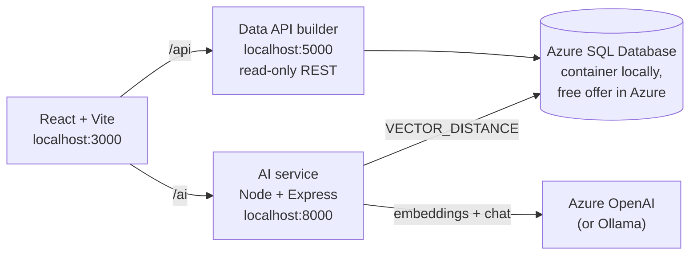

# [Microsoft Ignite](https://ignite.microsoft.com)

## 🔥 Build AI-ready apps on Azure SQL with GitHub Copilot in VS Code

Companion repository for the Microsoft Ignite session [**Build AI-ready apps on Azure SQL with GitHub Copilot in VS Code**](https://ignite.microsoft.com/en-US/sessions/1787856629889001EwSt-1791588244141001C6lW?source=sessions).

Welcome! In this hands-on lab, you build **CaseDesk**, an AI-ready customer-support app, on Azure SQL Database, using the MSSQL extension and GitHub Copilot in VS Code.

## Lab Overview

CaseDesk is a support console. A support engineer picks a customer case and gets a suggested reply drafted only from the approved knowledge base, with citations, or an honest "no matching article". You start from a React app on hardcoded data and give it a local Azure SQL database, a generated REST API, and vector search with grounded AI replies. Then you change the schema safely while data is live, and optionally move the database and API to Azure.

👉 **Start here: [the step-by-step walkthrough](docs/walkthrough/README.md).** Stuck? See [Troubleshooting](docs/walkthrough/troubleshooting.md).

## What you will learn

### 🧰 MSSQL extension features

| Feature | What you do with it | Step |
| --- | --- | --- |
| **Local container provisioning** (Preview) | Run the Azure SQL Database engine on your machine from **Getting Started**, without Docker commands | [2](docs/walkthrough/02-local-database.md) |
| **GitHub Copilot and the Microsoft SQL agent skills** | Create the database, check the schema, write queries, and change tables that hold data, with Copilot working against your real schema | [2](docs/walkthrough/02-local-database.md), [3](docs/walkthrough/03-schema.md), [9](docs/walkthrough/09-schema-change.md) |
| **Schema Designer** | See tables and relationships as a diagram, have Copilot design or change the schema, and publish the change to the database | [3](docs/walkthrough/03-schema.md), [9](docs/walkthrough/09-schema-change.md) |
| **Edit Table Data** | Change rows in a grid and review the generated SQL before saving | [4](docs/walkthrough/04-data.md), [9](docs/walkthrough/09-schema-change.md) |
| **SQL notebooks** | Keep queries, notes, and results in one file, and search by meaning alongside business data | [6](docs/walkthrough/06-vector-search.md) |
| **Data API builder** | Generate a read-only REST API over your tables, configured with Copilot | [5](docs/walkthrough/05-data-api.md) |
| **Query Store dashboard** (Preview) | Find a query by cost or frequency and open it in Copilot Chat with its runtime metrics | [8](docs/walkthrough/08-query-context.md) |
| **Local-to-cloud wizard** (Preview) | Deploy the local database's schema and data to Azure | [10](docs/walkthrough/10-deploy-to-azure.md) |
| **Azure SQL Database** | Create a free-offer database in Azure through the wizard, and connect with Microsoft Entra ID instead of a password | [10](docs/walkthrough/10-deploy-to-azure.md) |

Features marked (Preview) are in preview in the MSSQL extension and can change before general availability.

### 🧠 Building AI-ready apps on Azure SQL

By completing this lab, you will:

- **Search by meaning next to your data:** store embeddings in a native `VECTOR` column, and rank with `VECTOR_DISTANCE` in the same query that joins business tables ([step 6](docs/walkthrough/06-vector-search.md)).
- **Generate grounded AI replies:** retrieve evidence with SQL, cite it, and say "no match" instead of guessing ([step 7](docs/walkthrough/07-grounded-replies.md)).
- **Change the schema safely on live data:** add rules that the database validates against existing rows without breaking the running app ([step 9](docs/walkthrough/09-schema-change.md)).
- **Let the database create embeddings:** with Azure OpenAI, register the model with `CREATE EXTERNAL MODEL`, turn articles and questions into vectors in T-SQL with `AI_GENERATE_EMBEDDINGS`, and search by meaning in one statement ([step 6](docs/walkthrough/06-vector-search.md)).

## Lab Modules

The lab has six modules. Each step has its own page with copyable prompts and an expected result.

### 🚀 [Module 1: Set up and start local](docs/walkthrough/00-setup.md)

Steps [0](docs/walkthrough/00-setup.md), [1](docs/walkthrough/01-prototype.md), and [2](docs/walkthrough/02-local-database.md)

- Install the tools and add the Microsoft SQL agent skills to Copilot
- Run the app on hardcoded sample data
- Provision the Azure SQL Database container and create the database with Copilot

### 🧱 [Module 2: Design the schema and load data](docs/walkthrough/03-schema.md)

Steps [3](docs/walkthrough/03-schema.md) and [4](docs/walkthrough/04-data.md)

- Design the tables with Copilot in Schema Designer, from the app's sample data and the spec
- Publish the changes and confirm the tables in Object Explorer
- Load records and edit a row with Edit Table Data

### 🔌 [Module 3: Generate a REST API](docs/walkthrough/05-data-api.md)

Step [5](docs/walkthrough/05-data-api.md)

- Build a read-only REST API with Data API builder and Copilot
- Switch the app from sample data to live data

### 🔍 [Module 4: Add vector search and grounded replies](docs/walkthrough/06-vector-search.md)

Steps [6](docs/walkthrough/06-vector-search.md) and [7](docs/walkthrough/07-grounded-replies.md)

- Choose your AI path: Azure OpenAI (recommended) or Ollama on your machine
- Store article embeddings in a native `VECTOR` column; with Azure OpenAI, the database creates them itself with `AI_GENERATE_EMBEDDINGS`
- Combine `VECTOR_DISTANCE` with business data in one query
- Generate cited replies and honest no-match answers

### 🛠️ [Module 5: Tune and evolve the database](docs/walkthrough/08-query-context.md)

Steps [8](docs/walkthrough/08-query-context.md) and [9](docs/walkthrough/09-schema-change.md)

- Investigate a slow request with the Query Store dashboard and Copilot (optional)
- Change the schema with Copilot in Schema Designer, and apply it to tables that already hold data

### ☁️ [Module 6: Deploy to Azure](docs/walkthrough/10-deploy-to-azure.md) (optional)

Steps [10](docs/walkthrough/10-deploy-to-azure.md) and [11](docs/walkthrough/11-cleanup.md)

- Deploy the database to the Azure SQL Database free offer with the local-to-cloud wizard
- Run the same vector search in Azure, unchanged
- Clean up what you created

[Going further](docs/walkthrough/going-further.md): point the app at the Azure database, host the API on Azure Container Apps with the deploy-dab-to-azure skill, and query your data from Copilot through its MCP endpoint.

## Prerequisites

- [Visual Studio Code](https://code.visualstudio.com/) with the [MSSQL extension](https://marketplace.visualstudio.com/items?itemName=ms-mssql.mssql) and [GitHub Copilot](https://marketplace.visualstudio.com/items?itemName=GitHub.copilot-chat), signed in with access to agent mode.
- [Node.js](https://nodejs.org/) 22 or later, and [Git](https://git-scm.com/downloads).
- Windows with PowerShell. On macOS or Linux, use [PowerShell 7](https://learn.microsoft.com/powershell/scripting/install/installing-powershell).
- For the AI: [Ollama](https://ollama.com/download) on your machine, or an Azure subscription for Azure OpenAI. [Compare the two](docs/walkthrough/README.md#choose-your-ai-setup).
- For the optional Azure module: an Azure subscription and [Azure CLI](https://learn.microsoft.com/cli/azure/install-azure-cli). Hosting the API, in Going further, also needs permission to create app registrations and assign roles.
- Basic SQL knowledge helps. You don't need database administration experience.

The MSSQL extension guides you through installing a container engine and .NET when a step needs them.

## Getting Started

1. **Start with [step 0](docs/walkthrough/00-setup.md)** to install the tools, get the code, and add the SQL agent skills.
2. **Follow the steps in order.** Each one builds on the previous step.
3. **Paste each Copilot prompt and review what Copilot proposes** before you approve a change.
4. **Check the expected result** at the end of each step. If yours differs, see [Troubleshooting](docs/walkthrough/troubleshooting.md).

Ports and modes live in git-ignored local settings files that step 0 creates, never in source code. Only the frontend's `VITE_` settings reach the browser; never put secrets in them.

## Why Azure SQL for an AI-ready app

- **App data and AI search in one database.** One T-SQL query ranks articles by meaning and joins business data, with no separate vector store to sync.
- **The same engine locally and in Azure.** The local container runs the Azure SQL Database engine, and a wizard deploys schema and data to Azure.
- **Free to start.** The container is free, and the [Azure SQL Database free offer](https://learn.microsoft.com/azure/azure-sql/database/free-offer) can pause instead of billing at its monthly limit.

Evaluating Azure SQL beyond this app? See [what else to expect](docs/walkthrough/README.md#if-youre-evaluating-azure-sql): room to grow, more AI in the engine, built-in history and audit, columnstore reporting, and automatic tuning.

## Key Technologies



| Layer | Technology |
|---|---|
| Database | Azure SQL Database: the local container (`EngineEdition` 5) and the free offer in Azure |
| Tooling | MSSQL extension for VS Code, GitHub Copilot, [Microsoft SQL agent skills](https://github.com/microsoft/microsoft-sql) |
| Data API | Data API builder 2.1.5, generated from the MSSQL extension; optionally hosted on Azure Container Apps |
| AI service | Node.js 22+, TypeScript, Express, `mssql` |
| Embeddings | Azure OpenAI `text-embedding-3-small` at 768 dimensions, or Ollama `nomic-embed-text` |
| Frontend | React 19, Vite, TypeScript |

## Repository layout

```
├── app/
│   ├── frontend/            React app; starts on hardcoded data in src/data/sampleData.ts
│   └── ai-service/          Embedding backfill, vector search, grounded replies
├── database/                Reference schema, seed data, SQL queries, and a SQL notebook
├── dab/                     Reference Data API builder configuration
├── scripts/                 Azure OpenAI setup, API app registration, cloud settings, and local automation
├── docs/
│   ├── walkthrough/         Lab overview (README.md), one page per step, troubleshooting, and ai/ provider setup
│   └── PRD.md               What CaseDesk is (GitHub Copilot reads it too)
├── .github/copilot-instructions.md   Rules GitHub Copilot follows in this repo
├── AGENTS.md                Same rules for other AI agents
└── .vscode/                 Recommended workspace settings and extensions
```

## How the AI part stays honest

- **Embeddings live in their own table** (`kb_article_embeddings`), never in the business tables. Every row records the model that produced it, and retrieval filters on it, so vectors from different models are never compared. Switching between Azure OpenAI and Ollama is a re-embed, not a schema change.
- **Retrieval is plain T-SQL** with `VECTOR_DISTANCE('cosine', ...)`, parameterized, in [app/ai-service/src/repository.ts](app/ai-service/src/repository.ts).
- **Only close-enough articles are used.** The distance threshold is measured per model with `npm run calibrate`.
- **Citations are checked.** The service removes citations to articles it did not retrieve, flags drafts with none, and returns "no match" instead of an answer when nothing relevant was found ([rag.ts](app/ai-service/src/rag.ts), covered by `npm test`).
- **Drafts are for people.** Nothing is sent to a customer.

## Security notes

- No secrets in the repository. Local settings go in git-ignored `.env` files. The app reaches Azure OpenAI and Azure SQL Database with Microsoft Entra ID (`az login` locally), so it stores no key or cloud password. With Azure OpenAI, the database keeps the key it uses for embeddings in an encrypted database credential, never in a file.
- `sa` and `TrustServerCertificate=true` are for the local container only; the AI service refuses to trust the certificate for a non-local server.
- Data API builder runs locally in development mode with anonymous, **read-only** access to two tables. The AI service listens on `127.0.0.1` only. Neither is ready to expose on a network as is. [Going further](docs/walkthrough/going-further.md#host-the-api-on-azure-container-apps) hosts the API with Microsoft Entra ID sign-in, read access for authenticated callers only, and a managed identity to the database.

## Tests

```powershell
npm --prefix app/ai-service test       # RAG logic: threshold, citations, no-match, unavailable model
npm --prefix app/ai-service run build  # type check
npm --prefix app/frontend test         # inbox and reply interactions
npm --prefix app/frontend run build    # type check and production build
```

## Clean up

Follow the [cleanup page](docs/walkthrough/11-cleanup.md). Stop the local services and remove only the lab's containers. If you created Azure resources, remove those too; local-only Ollama users have no Azure lab resources to delete. The SQL free-offer database is set to pause, not bill, when its monthly free amount is used.

### 📚 Resources and Next Steps

| Resources | Links | Description |
|:--|:--|:--|
| MSSQL extension | [Microsoft Learn](https://learn.microsoft.com/sql/tools/visual-studio-code-extensions/mssql/mssql-extension-visual-studio-code) | Overview and documentation for the MSSQL extension for VS Code |
| Azure SQL Database free offer | [Microsoft Learn](https://learn.microsoft.com/azure/azure-sql/database/free-offer) | What the free offer includes and how its monthly limit works |
| Azure SQL Database container | [Documentation](https://microsoft.github.io/azure-sql-database-container/what-is-the-container.html) | The Azure SQL Database engine for local development |
| Vector data type | [Microsoft Learn](https://learn.microsoft.com/sql/t-sql/data-types/vector-data-type) | Store and search embeddings in Azure SQL |
| Data API builder | [Microsoft Learn](https://learn.microsoft.com/azure/data-api-builder/) | REST, GraphQL, and MCP endpoints over your database |
| Microsoft SQL agent skills | [GitHub](https://github.com/microsoft/microsoft-sql) | The skills that guide Copilot in this lab |

## Content Owners

<table>
<tr>
    <td align="center"><a href="https://github.com/yoleichen">
        <br />
        <sub><b>Yo-Lei Chen</b></sub></a><br />
    </td>
</tr>
</table>

## Credits

The demo structure follows Carlos Robles' [library-app](https://github.com/croblesm/library-app). This repository is an original implementation with its own scenario, code, and data. All companies and data are fictional.

## License

[MIT](LICENSE)
