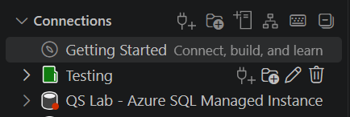
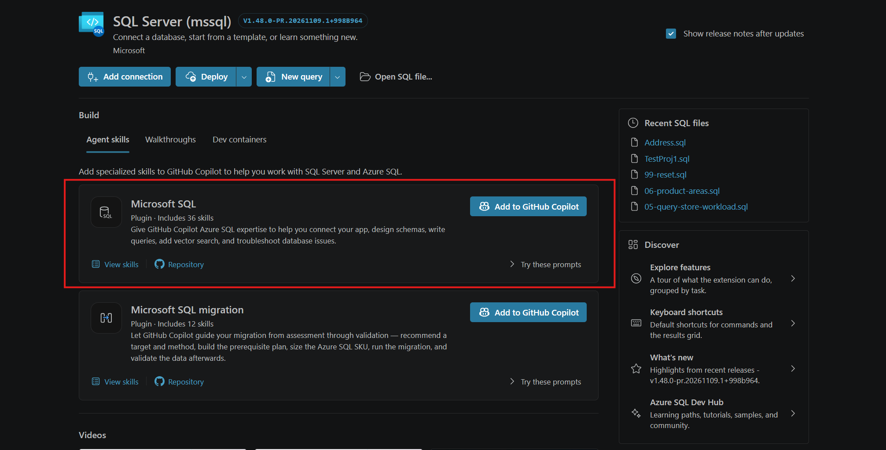
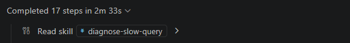

# 0. Set up

[Overview](README.md) | [Next: Start the prototype](01-prototype.md)

You install a few tools, get the code, and give Copilot Azure SQL knowledge. Nothing touches a database yet. You'll choose where the AI runs later, in [step 6](06-vector-search.md).

## Task 0.1: Install the tools

- [Visual Studio Code](https://code.visualstudio.com/).
- The [MSSQL extension](https://marketplace.visualstudio.com/items?itemName=ms-mssql.mssql). If you already have it, update it to the latest version; several features in this guide are new.
- [GitHub Copilot](https://marketplace.visualstudio.com/items?itemName=GitHub.copilot-chat), signed in. Several steps use **Agent** mode, where Copilot can run tools after you approve them.
- [Node.js](https://nodejs.org/) 22 or later. To check, run `node --version` in a terminal.
- [Git](https://git-scm.com/downloads).

This guide uses Windows and PowerShell. On macOS or Linux, install [PowerShell 7](https://learn.microsoft.com/powershell/scripting/install/installing-powershell) and run the commands in a `pwsh` terminal.

> [!TIP]
> When a later step needs a container engine or the .NET runtime, the MSSQL extension walks you through installing it. You don't need them now.

## Task 0.2: Get the code

1. On this repository's GitHub page, select **Code** and copy the HTTPS URL.
2. In VS Code, open the Command Palette (**Ctrl+Shift+P**), run **Git: Clone**, paste the URL, choose a folder, and select **Open** when VS Code offers to open the cloned repository.
3. If VS Code asks whether you trust the authors of the files in this folder, select **Yes, I trust the authors**; Restricted Mode turns off features this guide uses. If VS Code offers to install the repository's recommended extensions, select **Install**.
4. Select **Terminal > New Terminal**. Its prompt shows the repository folder, for example `PS [path]\ignite26-BRK373>`. Install the app dependencies and create your local settings files:

```powershell
npm --prefix app/frontend install
npm --prefix app/ai-service install
if (-not (Test-Path app/frontend/.env.local)) { Copy-Item app/frontend/.env.example app/frontend/.env.local }
if (-not (Test-Path app/ai-service/.env)) { Copy-Item app/ai-service/.env.example app/ai-service/.env }
```

The last two lines copy each app's example settings into git-ignored files that you'll edit in later steps, and keep any that you already have.

Run every command in this guide from the repository root.

## Task 0.3: Give Copilot Azure SQL skills

The Microsoft SQL agent skills teach Copilot details it would otherwise guess, such as T-SQL that runs on Azure SQL Database, how to change a table that already holds data, and how to host Data API builder in Azure.

1. In VS Code, select the **SQL Server** icon in the left side Activity Bar to open the MSSQL extension, then select **Getting Started** in the **Connections** view. Alternatively, open the Command Palette (**Ctrl+Shift+P**) and run **MS SQL: Open Getting Started**.

	

2. Under **Build**, select **Agent skills**.
3. On the **Microsoft SQL** card (not **Microsoft SQL migration**), select **Add to GitHub Copilot**. Review the plugin details and confirm.

	

Copilot now has Azure SQL guidance it reads only when a task needs it. It keeps each skill's short description in context and loads the full guidance for the matching task, such as diagnosing a slow query or changing a table that holds data. So it gets the details right more often on the first try, needs fewer retries, and doesn't spend tokens on guidance a request doesn't use.

In later steps, look for **Read skill**. For example, in step 8 Copilot reads `diagnose-slow-query` before it explains the query:



## Task 0.4: See how Copilot knows this project

Two files steer Copilot on every request, so prompts in this guide stay short:

- [docs/PRD.md](../PRD.md) says **what** to build: the data model, the API, and the changes you'll build in step 9 and in Going further.
- [.github/copilot-instructions.md](../../.github/copilot-instructions.md) says **how**: Azure SQL Database T-SQL only, lowercase snake_case names, and show SQL for review before running it.

Open both and skim them. Several prompts say "from docs/PRD.md" instead of repeating requirements.

> [!NOTE]
> **Expected result:** VS Code is open at the repository root, the dependencies are installed, `app/frontend/.env.local` and `app/ai-service/.env` exist, and the Microsoft SQL skills are added to Copilot.

---

[Overview](README.md) | [Next: Start the prototype](01-prototype.md) | [Troubleshooting](troubleshooting.md)