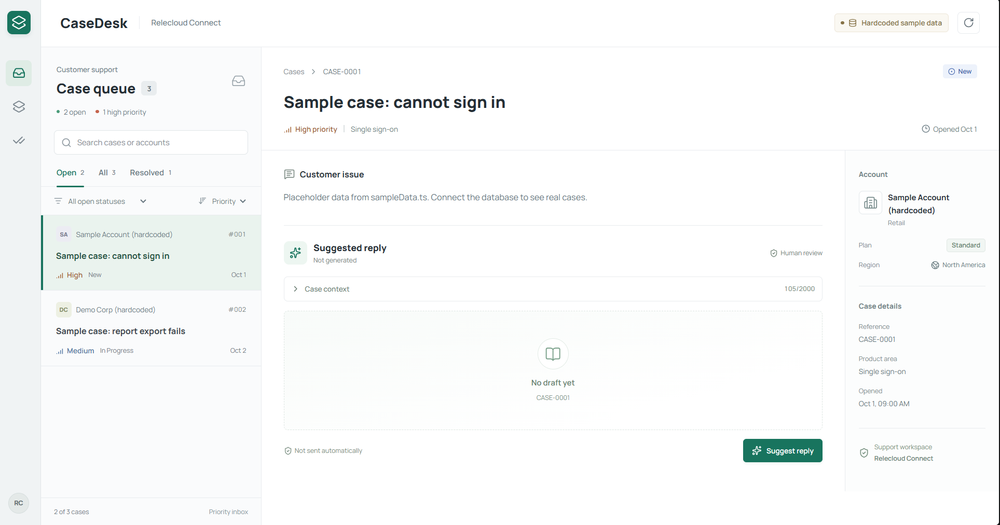

# 1. Start the prototype

[Previous: Set up](00-setup.md) | [Overview](README.md) | [Next: Create the local database](02-local-database.md)

The app's screens already work, but its data is hardcoded in TypeScript. The rest of this guide gives it a real database, an API, and AI, without rewriting the UI.

## Task 1.1: Run the app on sample data

1. Step 0 created `app/frontend/.env.local` with these default settings:

```dotenv
VITE_DATA_SOURCE=sample
DEV_SERVER_PORT=3000
DAB_URL=http://127.0.0.1:5000
AI_SERVICE_URL=http://127.0.0.1:8000
```

Keep these values for now. You don't need to check ports in advance; you'll change one only if the next step reports a conflict. The two service URLs are used in later steps. Only non-sensitive settings may use the `VITE_` prefix, because those values are included in the browser bundle.

2. Use the terminal from step 0 as your **frontend terminal**. From the repository root, run:

```powershell
npm --prefix app/frontend run dev
```

> [!IMPORTANT]
> **Port 3000 already in use?** If the terminal reports `Port 3000 is already in use`, another program is using that port. In `.env.local`, change `DEV_SERVER_PORT` to another port, such as `3001`, save the file, and run the command again.

In your browser, open the **Local** URL printed in the terminal (it should start with `http://127.0.0.1`). Leave the frontend terminal running. You'll see the CaseDesk frontend shown below.

Whenever you change `.env.local`, stop the server with **Ctrl+C** and run the same command again to load the new settings.



You can browse the sample cases, but the frontend isn't connected to a real database or the AI service yet. If you select **Suggest reply** now, the app shows **Reply unavailable** and the frontend terminal logs a proxy error; that's expected. You'll connect the database through an API in [step 5](05-data-api.md) and enable AI replies in [step 7](07-grounded-replies.md).

> [!NOTE]
> **Expected result:** the badge says **Hardcoded sample data**, and the queue shows **2 open cases out of 3 total**. The data comes from [sampleData.ts](../../app/frontend/src/data/sampleData.ts), which Copilot will use as the starting point for the tables in step 3.

---

[Previous: Set up](00-setup.md) | [Overview](README.md) | [Next: Create the local database](02-local-database.md) | [Troubleshooting](troubleshooting.md)