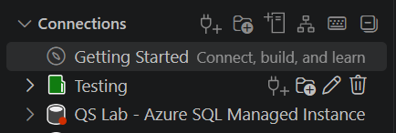
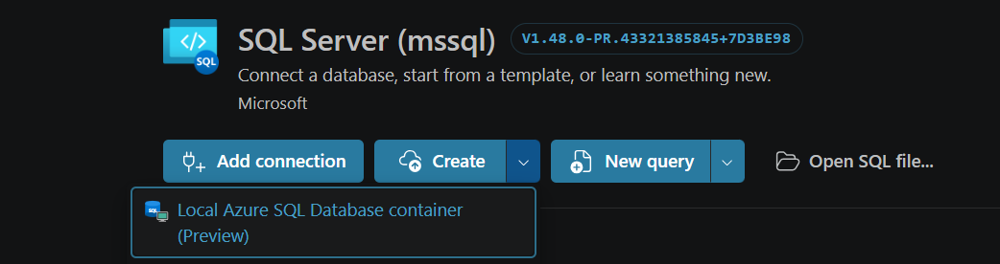
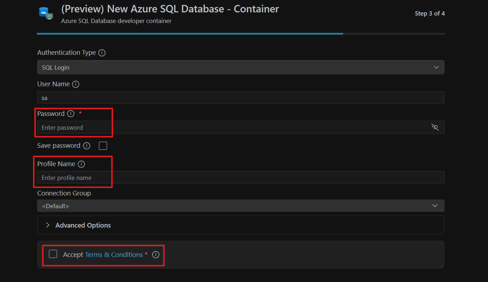
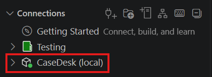

# 2. Create the local database

[Previous: Start the prototype](01-prototype.md) | [Overview](README.md) | [Next: Design the schema](03-schema.md)

You run the Azure SQL Database engine in a container on your machine. It's free, works offline, and behaves like the database you can later deploy to Azure, so what works here works there.

## Task 2.1: Create the container

1. In VS Code's far-left Activity Bar, select the **SQL Server** icon (hover to see its name). In **Connections**, select **Getting Started** at the top.

	

2. On the **Getting Started** page, open the dropdown arrow beside **Create** and select **Local Azure SQL Database container (Preview)** to open the container wizard.

	

3. For the container engine, select **Docker**. If Docker Desktop isn't installed or running, follow the wizard's prompts, then wait until Docker Desktop reports that it's running.
4. Keep **Authentication Type** as **SQL Login** and **User Name** as `sa`. Enter a strong **Password**; you'll save it for the app in Task 2.2.
5. Set **Profile Name** to `CaseDesk (local)`.

	

6. The container uses port **1433** if it's free. To see or change the port, expand **Advanced Options**. If yours isn't 1433, note it for Task 2.2.
7. Select **Accept Terms & Conditions**, then select **Create Container**.
8. Wait while the wizard downloads the image, starts the container, and connects. The first download is large and may take a while.
9. When the wizard finishes, **CaseDesk (local)** appears in the **Connections** view.

	

## Task 2.2: Save the password for the app

The AI service connects to this database in step 6. Save the connection details now, while you have them:

1. Open `app/ai-service/.env`, created in step 0.
2. Put your container password between the single quotes, for example `SQL_PASSWORD='Your#Pa55word'`. The quotes keep symbols such as `#` intact.
3. If your container's port isn't 1433, set `SQL_PORT` to it.
4. Save the file.

The other database settings already point at this container: server `localhost`, database `CaseDesk`, and user `sa`. The file is git-ignored, so the password stays on your machine.

## Task 2.3: Create the CaseDesk database with Copilot

1. In **Connections**, right-click **CaseDesk (local)** and select **Open in GitHub Copilot Agent**. This opens Copilot in **Agent** mode with your connection as context.
2. If prompted, approve the connection tool. Once Copilot confirms it's connected to **CaseDesk (local)**, paste this prompt:

**Copilot prompt 1: Create the database**

```text
Create a database named CaseDesk on this server if it does not exist.
Then connect to CaseDesk and show which database engine it runs, using
SERVERPROPERTY('EngineEdition') and SERVERPROPERTY('Edition').
Show each statement before you run it.
```

Once connected, GitHub Copilot is *schema-aware*: its schema tools read database structure (tables, columns, and relationships), not table contents. Read each statement before you approve the tool call that runs it.

Copilot should report engine edition **5** and edition **SQL Azure**. That is how Azure SQL Database identifies itself; SQL Server reports a different value.

> [!NOTE]
> **Expected result:** `app/ai-service/.env` contains your container password, the `CaseDesk` database exists, and Copilot confirmed engine edition **5** (**SQL Azure**). Wording and detail vary by model.

---

[Previous: Start the prototype](01-prototype.md) | [Overview](README.md) | [Next: Design the schema](03-schema.md) | [Troubleshooting](troubleshooting.md)