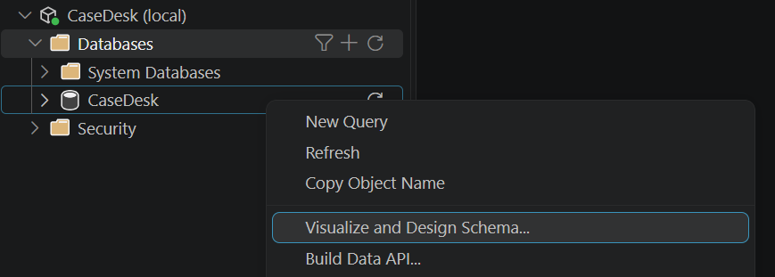
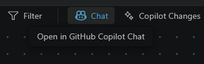
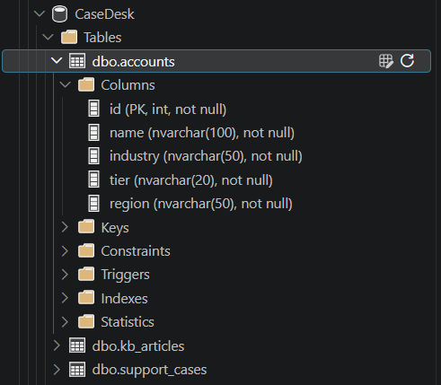

# 3. Design the schema

[Previous: Create the local database](02-local-database.md) | [Overview](README.md) | [Next: Load and edit data](04-data.md)

In Schema Designer, Copilot turns the app's sample data and the data model in the spec into a diagram of tables. You review its changes, publish them, add the rules that the diagram can't hold, then confirm the tables before loading data.

## Task 3.1: Open Schema Designer and Copilot

1. In **Connections**, under **CaseDesk (local) > Databases**, right-click **CaseDesk** and select **Visualize and Design Schema...**. The diagram is empty because the database has no tables yet.

   

2. Select **Chat** in the toolbar above the diagram, and wait for Copilot to finish its first response.

   

## Task 3.2: Design the tables with Copilot

1. In the chat, paste:

**Copilot prompt 2: Design the tables**

```text
Read app/frontend/src/data/sampleData.ts and docs/PRD.md.
Add accounts, support_cases, and kb_articles to match the spec,
including the foreign key from support_cases to accounts.
```

If Copilot can't read either file, attach it to the chat before continuing.

2. Copilot draws the tables in the diagram; nothing is saved yet. It might also say that the diagram can't hold the PRD's `UNIQUE` and `CHECK` rules. You'll add those in Task 3.3. Select **Copilot Changes** to review what it added: `INT IDENTITY` keys named `id`, `NVARCHAR` text columns, and a relationship from `support_cases` to `accounts`. Then select **Accept All**.
3. Select **Apply Changes**. Schema Designer shows a report of the changes. Review it, select **Publish**, and wait for **Changes published successfully**.

## Task 3.3: Add the rules the diagram can't hold

The PRD also has data rules: account names and article titles are unique, and `tier`, `priority`, and `status` allow only listed values. In SQL, those rules are `UNIQUE` and `CHECK` constraints. Copilot adds them with a script you review.

1. In the same chat, paste:

**Copilot prompt 2, follow-up: Add the data rules**

```text
Add the UNIQUE and CHECK rules from docs/PRD.md to the published
accounts, support_cases, and kb_articles tables with ALTER TABLE.
Show the T-SQL and wait for my approval before running it.
```

2. Review the script before you approve it. Look for:
   - `UNIQUE` on `accounts.name` and `kb_articles.title`.
   - `CHECK` on `accounts.tier`, `support_cases.priority`, and `support_cases.status`, each listing the values from the PRD.
3. Approve it, and wait for Copilot to report that the script ran.

## Task 3.4: Confirm the tables in Object Explorer

1. In **Connections**, expand **CaseDesk (local) > Databases > CaseDesk > Tables**. If the new tables aren't listed, right-click **Tables** and select **Refresh**.
2. Confirm that `dbo.accounts`, `dbo.support_cases`, and `dbo.kb_articles` are listed. Expand a table's **Columns** folder to see the fields Copilot created.

	

> [!TIP]
> **Tables don't match the spec, or the seed in step 4 fails?** Start over from the reference tables. Open [99-reset.sql](../../database/99-reset.sql), set `@confirm` to `N'RESET CaseDesk'`, and run it on **CaseDesk**; then run [01-schema.sql](../../database/01-schema.sql). [Task 4.1](04-data.md#task-41-load-the-records) shows how to run a script.

> [!NOTE]
> **Expected result:** the three business tables are visible under **CaseDesk**, with their keys, relationship, and data rules, ready for the next step to load data. [01-schema.sql](../../database/01-schema.sql) shows a reference version of these tables.

---

[Previous: Create the local database](02-local-database.md) | [Overview](README.md) | [Next: Load and edit data](04-data.md) | [Troubleshooting](troubleshooting.md)