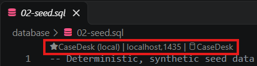
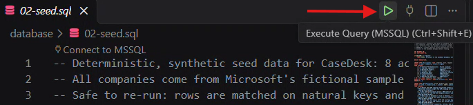
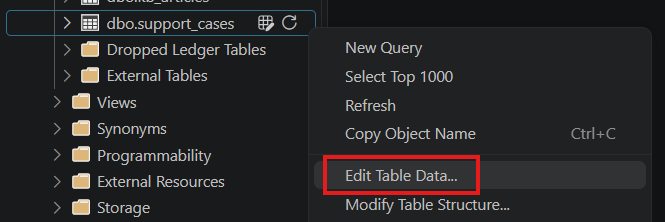
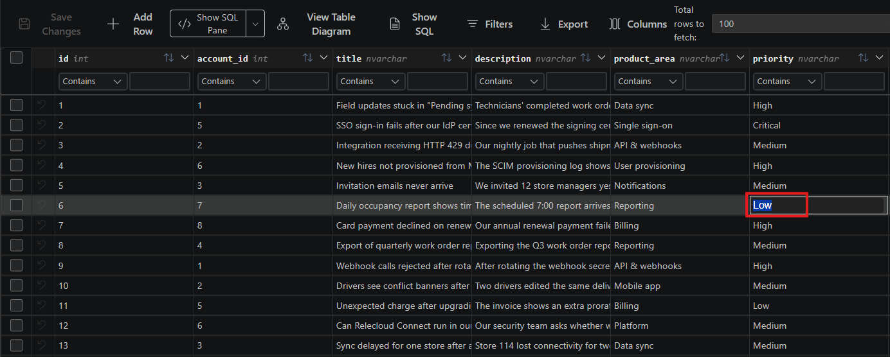
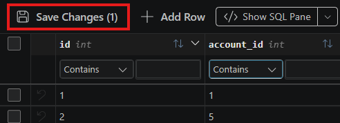

# 4. Load and edit data

[Previous: Design the schema](03-schema.md) | [Overview](README.md) | [Next: Connect a REST API](05-data-api.md)

You load realistic records and fix one value without writing SQL.

## Task 4.1: Load the records

1. Open [02-seed.sql](../../database/02-seed.sql).
2. In the connection bar above the SQL code, confirm that **CaseDesk (local)** is selected as the connection and **CaseDesk** as the database.

	

3. Execute the query using the **Execute Query** button at the top right of the editor, or press **Ctrl+Shift+E**.

	

4. Check the result counts: **8 accounts**, **24 support cases**, and **12 knowledge articles**. If the script fails, see the tip at the end of [step 3](03-schema.md).

## Task 4.2: Fix one value without writing SQL

A support lead says case 6 is more urgent than it looks. Edit Table Data changes it in a grid and shows the SQL it will run.

1. In the **MSSQL extension** view, expand **Tables** under **CaseDesk**. Double-click **dbo.support_cases**, or right-click it and select **Edit Table Data...**.

	

2. Find the row with **id 6**.
3. Go to the `priority` column in that row, double-click the cell, and change its value from `Low` to `High`.

	

4. Select **Save Changes** in the toolbar at the top left.

	

5. Confirm the grid now shows **High** for case 6.

> [!NOTE]
> **Expected result:** case 6 has priority **High**. You will see this edit in the app after connecting the API in step 5.

---

[Previous: Design the schema](03-schema.md) | [Overview](README.md) | [Next: Connect a REST API](05-data-api.md) | [Troubleshooting](troubleshooting.md)