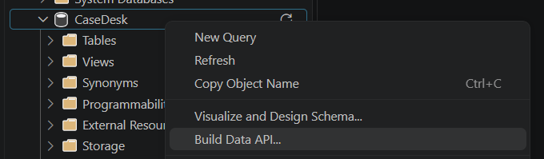
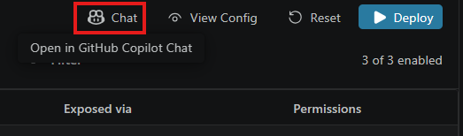
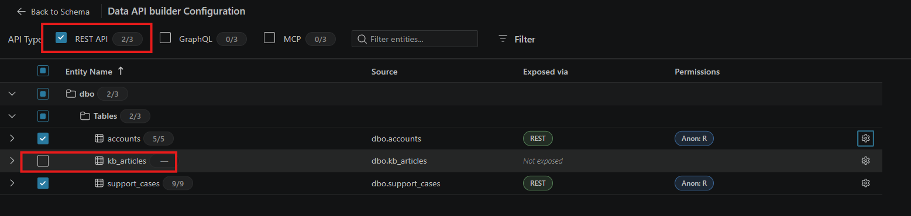
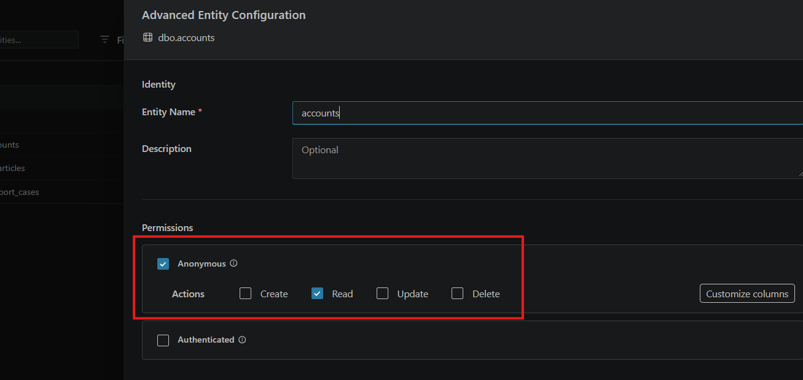
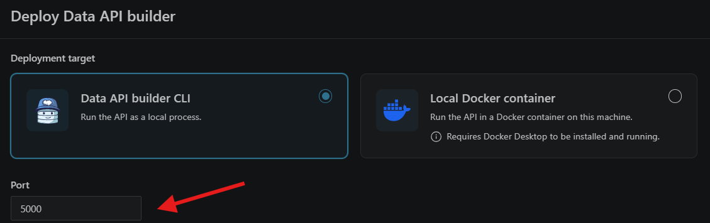
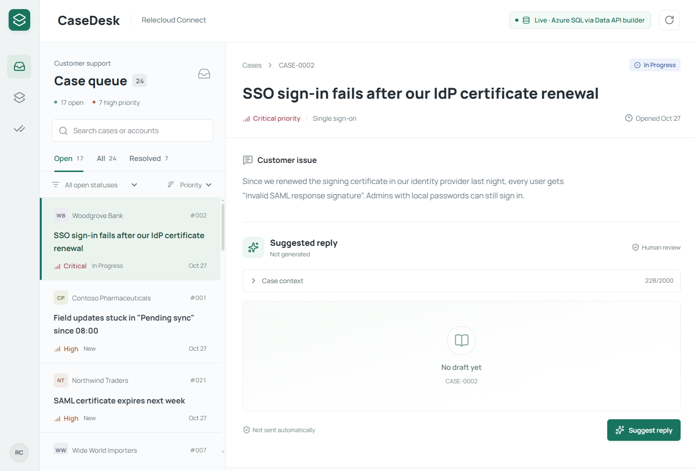

# 5. Connect a REST API

[Previous: Load and edit data](04-data.md) | [Overview](README.md) | [Next: Add vector search](06-vector-search.md)

The app needs an API to read cases. Data API builder (DAB) generates REST endpoints straight from your tables, so there are no controllers or data-access code to write.

## Task 5.1: Generate the API with Copilot

1. In the MSSQL extension, right-click **CaseDesk** and select **Build Data API...**.

	

2. Select **Chat** in the **Data API builder** toolbar at the top.

	

3. Wait for Copilot to finish responding to Data API builder's initial prompt, then paste this prompt and select **Send**:

**Copilot prompt 3: Configure the data API**

```text
Keep only the accounts and support_cases entities. Make both read-only:
enable Read and disable Create, Update, and Delete for anonymous access.
Enable REST only; disable GraphQL and MCP.
Do not expose kb_articles or any embeddings table.
Keep the entity names accounts and support_cases so the REST paths are
/api/accounts and /api/support_cases. Show the configuration for review.
```

4. Review the entity list: only **REST API** should be selected, with **GraphQL** and **MCP** unchecked. Tables `accounts` and `support_cases` are selected, and `kb_articles` is deselected.

	

5. Select the gear icon at the far right of the `accounts` row to open **Advanced Entity Configuration**. Under **Anonymous**, confirm that only **Read** is enabled; **Create**, **Update**, and **Delete** must be unchecked. Repeat for `support_cases`. These settings keep the API read-only.

	

6. Select **Deploy** at the top right.
7. Select **Data API builder CLI**. The **Port** is **5000** by default. If the dialog reports that the port is in use, enter another, such as `5001`, and note it. The first installation of DAB may take a while.

	

8. Open http://127.0.0.1:5000/api/accounts. If you use another port, open `http://127.0.0.1:<port-number>/api/accounts` instead, replacing `<port-number>` with the port you noted. Confirm that it returns account records.

Data API builder runs in the background, without a terminal; the **Build Data API** page shows **Running on port** with your port. It keeps running when you close VS Code. After you restart your computer, start it again as described in [Coming back after a break](troubleshooting.md#coming-back-after-a-break).

## Task 5.2: Switch the app to live data

1. Open `app/frontend/.env.local`, created in step 0. Change `VITE_DATA_SOURCE` from `sample` to `dab`, and make `DAB_URL` match the API address from Task 5.1. For example:

```dotenv
VITE_DATA_SOURCE=dab
DAB_URL=http://127.0.0.1:<port-number>
```

Keep `DAB_URL=http://127.0.0.1:5000` if you used the default API port. Leave `DEV_SERVER_PORT` and `AI_SERVICE_URL` as they are; changing the API port doesn't change the frontend port.

2. Save the file. In the frontend terminal, press **Ctrl+C**, then start the frontend again:

```powershell
npm --prefix app/frontend run dev
```

3. Open the **Local** URL printed in the frontend terminal. The Vite proxy forwards `/api` requests to `DAB_URL`; the browser still uses the frontend's address. Do not edit the application source, add browser credentials, or change CORS settings.

	

> [!NOTE]
> **Expected result:** the badge says **Live · Azure SQL via Data API builder**, the Open filter shows **17 of 24 cases**, and case 6 has **High** priority, the edit you made in step 4.

> [!IMPORTANT]
> The API runs on your machine without sign-in. Before hosting it or allowing writes, add authentication and roles; [Going further](going-further.md#host-the-api-on-azure-container-apps) hosts it in Azure with Microsoft Entra ID sign-in.

---

[Previous: Load and edit data](04-data.md) | [Overview](README.md) | [Next: Add vector search](06-vector-search.md) | [Troubleshooting](troubleshooting.md)