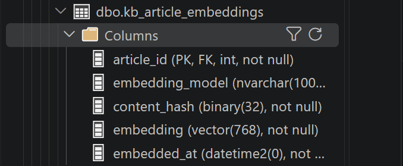
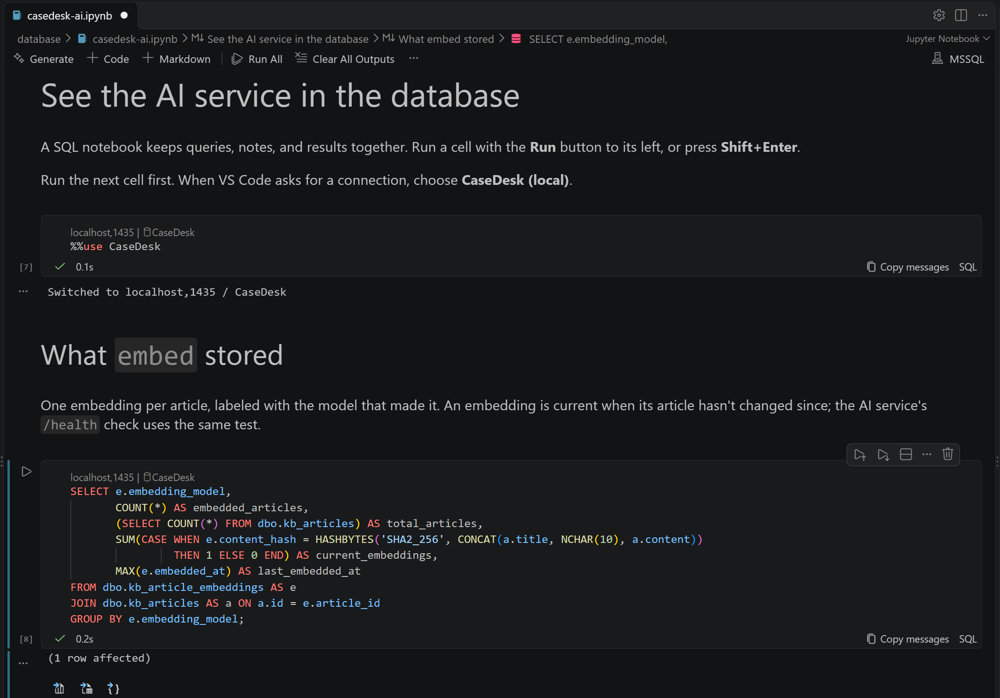

# 6. Add vector search

[Previous: Connect a REST API](05-data-api.md) | [Overview](README.md) | [Next: Generate grounded replies](07-grounded-replies.md)

To suggest a reply, CaseDesk must find articles that *mean* the same thing as a case, even when they use different words. An **embedding** is a list of numbers that captures a text's meaning: similar meanings produce nearby numbers. Azure SQL stores embeddings in a native `VECTOR` column next to your data, so one query can combine meaning with joins and filters.

## Task 6.1: Choose where the AI runs

From here on, you need a second VS Code terminal for commands that run and finish. Select **Terminal > New Terminal** to open it; this guide calls it the **command terminal**. Your first terminal keeps running the frontend. When VS Code has more than one terminal, it lists them at the right side of the Terminal panel; select one to switch to it.

Pick one path. From Task 6.3 on, follow only your path's steps. Both end with the same embeddings table, the same kind of search, and the same app.

| Path | Choose it when | Setup |
| --- | --- | --- |
| **Azure OpenAI** (recommended) | You want the live session's setup: the **database** calls the embedding model itself, with T-SQL, and replies come from a hosted model. Usage is billed, and you must be able to grant yourself access to the models. If you created your Azure subscription, you can. | [Set up Azure OpenAI](ai/azure-openai.md) |
| **Ollama** | You want to learn for free and offline. The models run **only on your machine**, so the **app** creates the embeddings: the database can only call a model over HTTPS. Replies come from a small model, at the speed your hardware allows. | [Set up Ollama](ai/ollama.md) |

Complete one setup page, then return to Task 6.2. The [overview compares the paths in detail](README.md#choose-your-ai-setup).

## Task 6.2: Add the embeddings table with Copilot

1. Go back to your Copilot session
2. Paste:

**Copilot prompt 4: Add vector storage**

```text
Add the kb_article_embeddings table from the data model in docs/PRD.md
to CaseDesk. Keep vectors out of the business tables. Show the script
and wait for my approval before running it.
```

3. Review the script, then approve it. Look for:
   - `embedding VECTOR(768)`: 768 numbers per article, the size both paths produce.
   - `embedding_model`: which model made each vector, so vectors from different models are never compared.
   - A foreign key to `kb_articles` with cascade delete: deleting an article deletes its embedding.

4. In **Connections**, expand **CaseDesk > Tables > dbo.kb_article_embeddings > Columns**. If the table isn't listed, right-click **Tables** and select **Refresh**. Confirm that `embedding` is `vector(768)`.

	

[03-vectors.sql](../../database/03-vectors.sql) shows a reference version of the table. If Copilot's table differs or wasn't created, run that script on **CaseDesk** instead.

## Task 6.3: Generate the embeddings

Now fill the table: one embedding per article. You'll work in a **SQL notebook**, a file that keeps queries, notes, and their results together, run by the MSSQL extension. The commands below connect to your local database with the password you saved in step 2.

Follow your path.

### Azure OpenAI: the database creates the embeddings

1. Store your Azure OpenAI key in the database. In the command terminal, whose prompt ends with the repository folder (`...\ignite26-BRK373>`), run:

```powershell
npm --prefix app/ai-service run credential
```

The [command](../../app/ai-service/src/credential.ts) reads your endpoint from `app/ai-service/.env` and the resource's key through your Azure CLI sign-in, without printing it. In the local **CaseDesk** database, it creates a master key if there isn't one, and a database scoped credential that holds the key, encrypted. Only the database can use it, and the key never appears in a prompt, file, or terminal.

**Check:** the output ends with `In the notebook, replace <your-resource> with:` and your resource name.

2. In the VS Code Explorer, open [database/embed-in-database.ipynb](../../database/embed-in-database.ipynb). If VS Code asks you to select a kernel, select **MSSQL**.
3. In the cell under **1. Register the model**, replace `<your-resource>` in both places with the name the command printed.
4. Run the cells one at a time, top to bottom, with the **Run** button beside each. When VS Code asks for a connection, choose **CaseDesk (local)**. Read each heading before you run its cell:
   - **Register the model:** `CREATE EXTERNAL MODEL` tells the database where your embedding model is and which credential to use. **Check:** `status` shows **ready**.
   - **Embed the articles:** `AI_GENERATE_EMBEDDINGS` sends each article to the model and stores the vector it returns. **Check:** 12 embedded articles of 12.
   - **Ask a question in plain English:** the database turns the question into a vector, ranks the articles by meaning, and counts the open cases in each article's product area, in one statement. **Check:** **KB-3, Data sync is delayed or stuck in Pending**, comes first.

<!-- Screenshot to add: embed-in-database.ipynb after section 3 ran on CaseDesk (local), showing AI_GENERATE_EMBEDDINGS in the cell and three ranked articles with KB-3 first. File: ../images/06-embed-in-database.png -->

> [!TIP]
> **`Msg 31622` when you embed the articles?** Some preview builds of the local container can't call out to a model yet. Run `npm --prefix app/ai-service run embed` in the command terminal instead: the AI service stores the same vectors with the same label. Skip the question cell for now; step 10 runs it in Azure.

### Ollama: the app creates the embeddings

1. Make sure both model downloads have finished: `ollama list` in their separate PowerShell window shows both models.
2. In the command terminal, whose prompt ends with the repository folder (`...\ignite26-BRK373>`), run:

```powershell
npm --prefix app/ai-service run embed
```

The AI service sends each article to Ollama and stores the 768 numbers it returns, with the model's name.

**Check:** the output ends with **12/12 articles have current embeddings**, and the model name starts with `ollama:`.

3. In the VS Code Explorer, open [database/casedesk-ai.ipynb](../../database/casedesk-ai.ipynb). If VS Code asks you to select a kernel, select **MSSQL**.
4. Select **Run All** in the notebook toolbar. When VS Code asks for a connection, choose **CaseDesk (local)**. The first cell confirms the connection, and **MSSQL** shows as the kernel at the top right.

	

5. Read each result under its heading. **Combine meaning with business data** ranks the three articles closest in meaning to the SCIM provisioning article, KB-2, and counts the open support cases in each article's product area, in one statement. A smaller `cosine_distance` means closer in meaning.

### Both paths: what you just did

One query ranked articles by meaning *and* joined business data. With a separate vector database, this would take two systems and code to merge the results. To start your own notebook later, right-click **CaseDesk** in **Connections** and select **New SQL Notebook**.

> [!NOTE]
> **Expected result:** all 12 articles have embeddings from your path's model, and your notebook's last query returns **three articles** ordered by increasing distance, each with its product area and number of open cases. With Azure OpenAI, the database created every embedding itself.

---

[Previous: Connect a REST API](05-data-api.md) | [Overview](README.md) | [Next: Generate grounded replies](07-grounded-replies.md) | [Troubleshooting](troubleshooting.md)