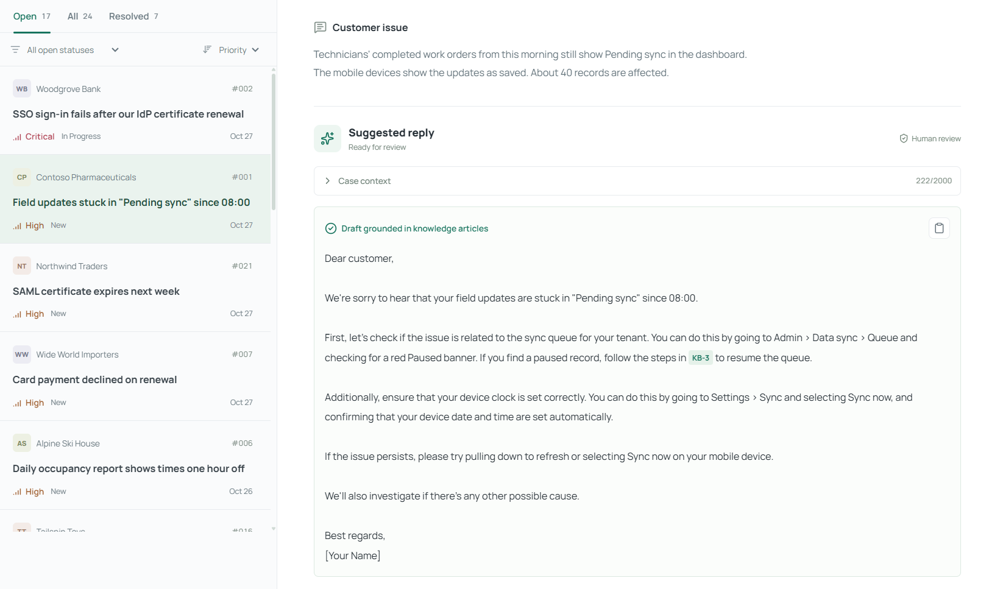

# 7. Generate grounded replies

[Previous: Add vector search](06-vector-search.md) | [Overview](README.md) | [Next: Investigate a slow request (optional)](08-query-context.md)

**Suggest reply** uses retrieval-augmented generation (RAG): the AI service finds the closest articles with a SQL vector query, then asks the model to answer using only those articles and to cite them. You run it and see how it refuses to guess.

## Task 7.1: Calibrate and start the AI service

1. In the command terminal, run:

```powershell
npm --prefix app/ai-service run calibrate
```

Calibration embeds sample cases that an article answers and sample cases that no article covers, then sets the cutoff halfway between them: how close an article must be to count as relevant **for your model**. It saves the result as `RAG_MAX_DISTANCE` in `app/ai-service/.env`. This cutoff is what stops the model from answering cases your articles don't cover, so run `calibrate` again whenever you change models.

2. Select **Terminal > New Terminal** to open a third terminal. This guide calls it the **AI service terminal**. Start the AI service there and leave it running:

```powershell
npm --prefix app/ai-service run dev
```

When it's ready, the terminal prints its address, `CaseDesk AI service on http://127.0.0.1:8000`, and the cutoff it loaded, `max distance`, which should match what `calibrate` saved.

> [!IMPORTANT]
> **Port 8000 already in use?** If the terminal prints `Port 8000 is already in use` instead, the service stops; it doesn't pick another port for you. Use `8001`: set `PORT=8001` in `app/ai-service/.env` and `AI_SERVICE_URL=http://127.0.0.1:8001` in `app/frontend/.env.local`. Run the AI service again and check that it prints the new address, then restart the frontend in the frontend terminal.

3. Open `/health` at the address the terminal printed, for example http://127.0.0.1:8000/health. Check that `status` is `ok`, `engine_edition` is **5**, `stale_or_missing` is **0**, and `ai.provider` is `azure` or `ollama`, matching your choice.

## Task 7.2: Try an answerable and an unsupported case

1. In the app, select **case 1: Field updates stuck in "Pending sync" since 08:00**, then **Suggest reply**. Read the draft, its `KB-3` citation, and the **Knowledge sources** list. Select the citation to jump to its source.

	

2. Select **case 12: Can Relecloud Connect run in our own data center?**, then **Suggest reply**. The app shows **No matching knowledge article** instead of inventing an answer about hosting.

> [!NOTE]
> **How it decides:** the service keeps only articles within the calibrated distance. If none qualify, or the model says the articles don't answer the case, you get the no-match result. Citations to articles that weren't retrieved are removed. A person still reviews every draft before it's sent.

> [!TIP]
> **Your local app is complete.** Continue with [step 8](08-query-context.md) to investigate a slow request with Query Store, which is optional, or go to [step 9](09-schema-change.md) for a schema change on live data, the kind of task that's easy to get wrong by hand.

---

[Previous: Add vector search](06-vector-search.md) | [Overview](README.md) | [Next: Investigate a slow request (optional)](08-query-context.md) | [Troubleshooting](troubleshooting.md)