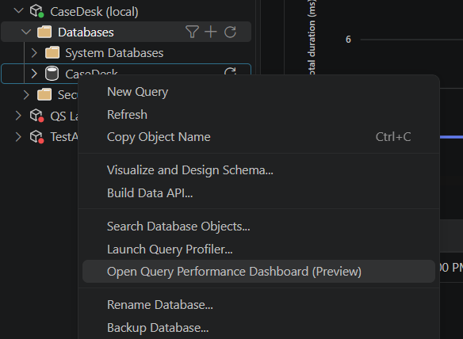
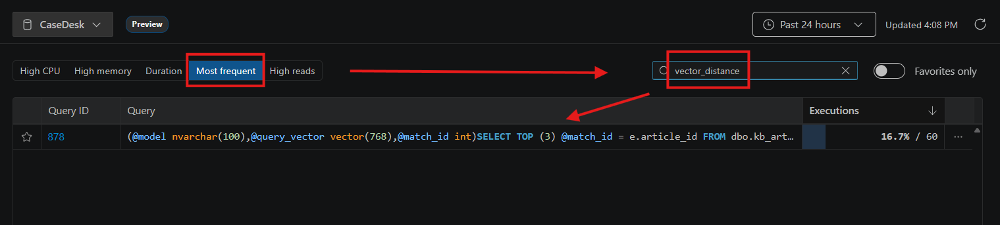
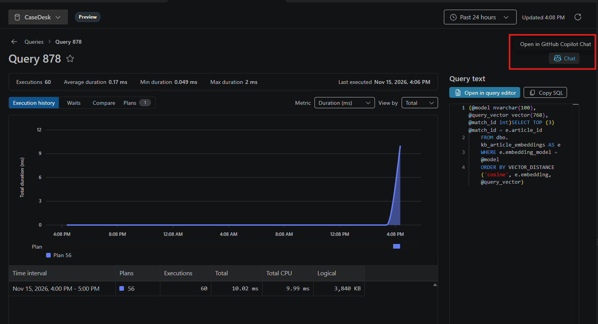

# 8. Investigate a slow request (Optional)

[Previous: Generate grounded replies](07-grounded-replies.md) | [Overview](README.md) | [Next: Change the schema on live data](09-schema-change.md)

> [!NOTE]
> This step is **optional**: nothing later depends on it. To skip it, go to [step 9](09-schema-change.md).

Imagine support engineers report that **Suggest reply** feels slow. Query Store, built into Azure SQL, records how long each query runs and how much it reads. Copilot can explain a query using those numbers, so you know where the time goes before you change anything.

## Task 8.1: Find and explain the slow query

1. Open [05-query-store-workload.sql](../../database/05-query-store-workload.sql), check that the connection bar shows **CaseDesk (local)** and **CaseDesk**, and run it. It simulates a busy period: 60 queue loads and 60 article searches. The result shows those two queries with **60** executions each, or more if you've run the script before.
2. In the MSSQL extension, under **CaseDesk (local) > Databases**, right-click **CaseDesk** and select **Open Query Performance Dashboard (Preview)**.

	

3. The dashboard opens on **High CPU**, where the extension's own catalog queries come first. Select **Most frequent**, then type `VECTOR_DISTANCE` in **Search queries**. The query with **60** executions is the article search behind **Suggest reply**.

	

4. Select its **Query ID** to open its details, then select **Chat** at the top. The database, query, and time range go into Copilot Chat.

	

5. After the initial prompt finishes, paste:

**Copilot prompt 5: Explain the slow query**

```text
Support engineers say Suggest reply feels slow. Using this query's
Query Store metrics, explain what it spends its time on, why it reads
every embedding for the model, and how that changes at a million
articles, including what Azure SQL offers at that scale. Explain only;
do not create indexes or change settings.
```

<!-- Screenshot to add: Copilot Chat after prompt 5, with the query context populated and the start of Copilot's explanation. File: ../images/08-query-store-copilot.png -->

> [!NOTE]
> **Expected result:** Copilot uses the query's Query Store metrics to show that the search is fast at 12 articles, explains that it compares the question with every stored embedding, so its cost grows with the number of articles, and describes what Azure SQL offers at a larger scale, such as a vector index. Wording and detail vary by model.

---

[Previous: Generate grounded replies](07-grounded-replies.md) | [Overview](README.md) | [Next: Change the schema on live data](09-schema-change.md) | [Troubleshooting](troubleshooting.md)