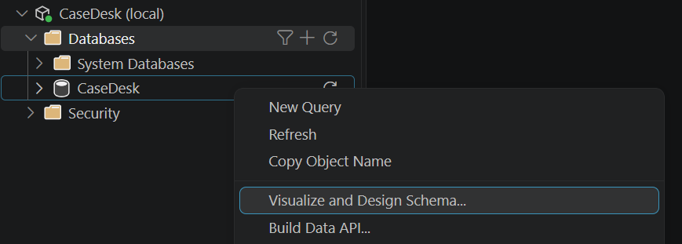
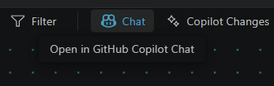

# 9. Change the schema on live data

[Previous: Investigate a slow request](08-query-context.md) | [Overview](README.md) | [Next: Deploy the database to Azure](10-deploy-to-azure.md)

`product_area` is free text in two tables, so nothing stops a typo: a case saved as `Reports` instead of `Reporting` quietly drops out of the Reporting counts. In this step, you make the schema changes with Copilot in **Schema Designer** and fill the list with a SQL script, saving each change to the database. Keep Data API builder and the frontend running; the change doesn't affect them.

## Task 9.1: Open Schema Designer and Copilot

1. Under **CaseDesk (local) > Databases**, right-click **CaseDesk** and select **Visualize and Design Schema...**. Schema Designer shows your tables and their relationships as a diagram.

   

2. Select **Chat** in the toolbar above the diagram, and wait for Copilot to finish its first response.

   

## Task 9.2: Add the table in Schema Designer

1. In the chat, paste:

**Copilot prompt 6: Add the product areas table**

```text
Add a product_areas table whose only column, name nvarchar(50), is the
primary key. Don't add foreign keys yet.
```

2. Copilot draws the new table in the diagram; nothing is saved yet. Select **Copilot Changes** to review what it changed, then select **Accept All**. Accept Copilot's changes before you send another prompt; the next change builds on them.
3. Select **Apply Changes**. Schema Designer shows a report of the changes. Review it, select **Publish**, and wait for **Changes published successfully**. Select **Continue Editing**.

## Task 9.3: Fill the list with a SQL script

Schema Designer changes structure, not data. The new list must hold every product area already in use before the tables can reference it, because a foreign key checks every existing row.

1. Open [06-product-areas.sql](../../database/06-product-areas.sql), check that the connection bar shows **CaseDesk (local)** and **CaseDesk**, and run it. The result lists **10** product areas.

## Task 9.4: Connect the tables in Schema Designer

1. Return to Schema Designer's chat and paste:

**Copilot prompt 7: Connect the tables**

```text
Make support_cases.product_area and kb_articles.product_area foreign
keys to product_areas.name.
```

2. Copilot draws a relationship from each table to `product_areas`. As before, review it in **Copilot Changes**, select **Accept All**, then select **Apply Changes** > **Publish**.

<!-- Screenshot to add: Schema Designer after prompt 7. Show product_areas connected to support_cases and kb_articles, and the Apply Changes report. File: ../images/09-schema-designer-publish.png -->

> [!TIP]
> If a publish fails, paste the error into the same chat and ask Copilot to fix it.

## Task 9.5: See the database enforce the list

1. In **Connections**, under **CaseDesk > Tables**, right-click **dbo.support_cases** and select **Edit Table Data...**.
2. In case **6**, change `product_area` from `Reporting` to `Reports`, then select **Save Changes**. The save fails because `Reports` isn't in the list. Select **Revert Row**.
3. Refresh the app. Nothing changed for its users: the Open filter still shows **17 of 24 cases**.

<!-- Screenshot to add: Product-area guard. Show Edit Table Data rejecting Reports for case 6 with the foreign key error. File: ../images/09-product-area-guard.png -->

> [!NOTE]
> **Expected result:** `product_areas` holds **10** areas, and Schema Designer shows it connected to `support_cases` and `kb_articles`. The database rejects a product area that isn't in the list, and the app works as before.

---

[Previous: Investigate a slow request](08-query-context.md) | [Overview](README.md) | [Next: Deploy the database to Azure](10-deploy-to-azure.md) | [Troubleshooting](troubleshooting.md)
