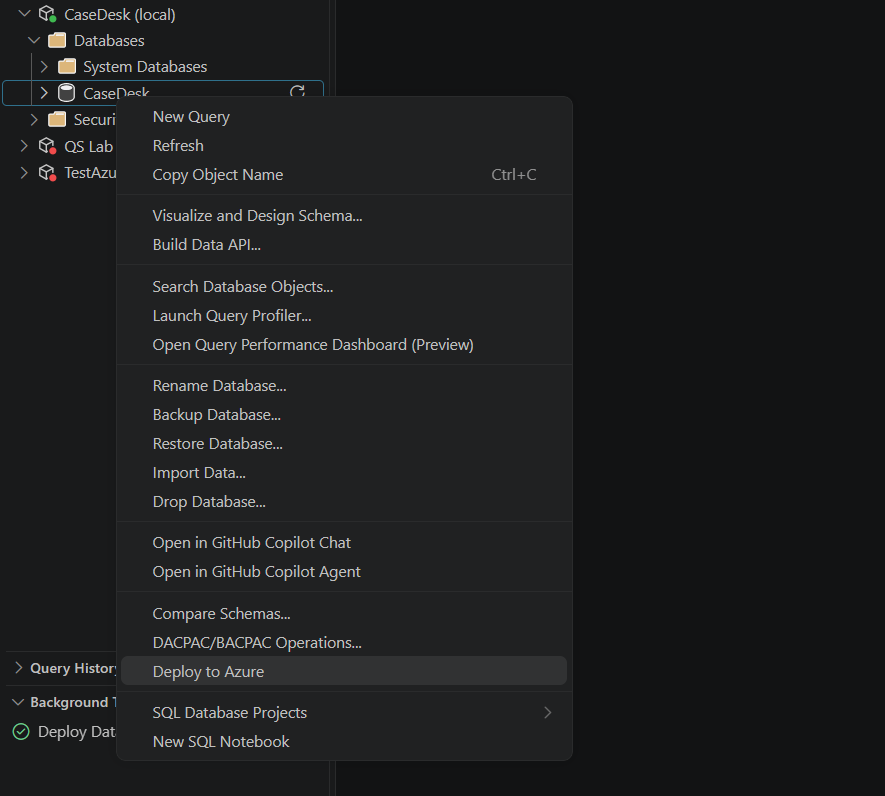
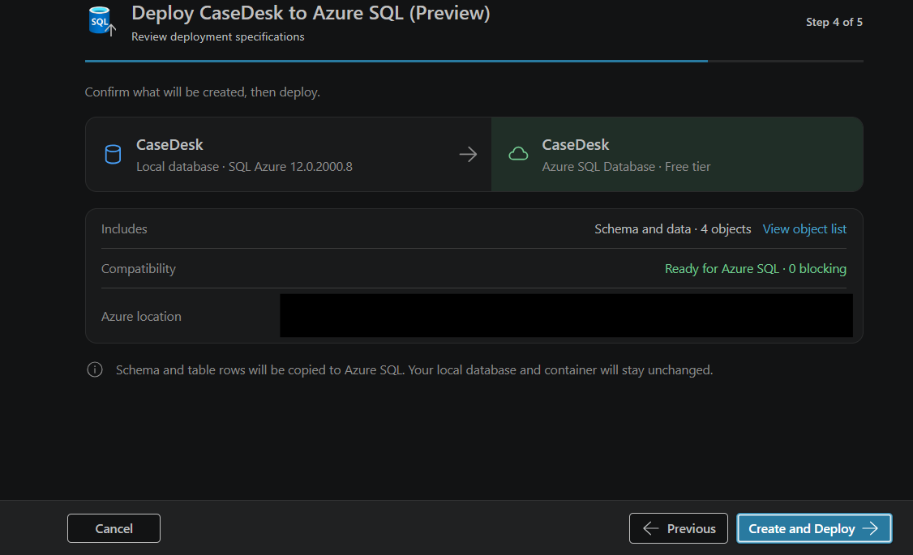

# 10. Deploy the database to Azure

[Previous: Change the schema on live data](09-schema-change.md) | [Overview](README.md) | [Next: Clean up](11-cleanup.md)

> [!NOTE]
> This step is **optional**. You move the database to Azure and check it there, without changing the app. If you're keeping everything local, go to [clean up](11-cleanup.md).

## Why move the database to Azure

- **It no longer depends on your laptop.** Teammates and hosted services can reach it.
- **Azure runs it for you:** automatic backups you can restore to a point in time, engine updates, and high availability.
- **No database password.** You sign in with Microsoft Entra ID, the same identity you use for Azure.
- **Room to grow.** Scale up or change tiers later without changing your app's code.

The wizard copies schema **and** data, so your embeddings come along and don't need to be regenerated. The local container stays as your development database. Your AI provider doesn't change, Ollama included.

## Task 10.1: Deploy with the local-to-cloud wizard

You need an Azure subscription where you can create a database. The wizard signs you in to Azure.

1. **Azure OpenAI path only:** remove the external model from the local database first. The wizard can't carry it: the model points to a credential, and the credential's key never leaves the database, so the wizard's compatibility build fails with `SQL71501`. In **Connections**, right-click **CaseDesk** and select **New Query**, then run:

```sql
IF EXISTS (SELECT 1 FROM sys.external_models WHERE name = N'casedesk_embeddings')
    DROP EXTERNAL MODEL casedesk_embeddings;
```

The embeddings stay and move with the data. Task 10.2 creates the model again in Azure. To use it locally again later, run the notebook's **Register the model** cell on **CaseDesk (local)**.

2. In the MSSQL extension, under **CaseDesk (local)**, right-click the **CaseDesk** database and select **Deploy to Azure**.

	

3. Under **What to deploy**, review both choices:

| Choice | What is copied |
| --- | --- |
| **Schema only** | Tables and other schema objects, without rows |
| **Schema and data** | Schema and rows, including the embeddings |

4. Select **Schema and data**, then run **Compatibility** and review the results. If the wizard asks to install .NET, follow its prompts.
5. On **Azure**, sign in and choose the subscription and resource group. Create a logical server with **Microsoft Entra ID** authentication, or choose one you already use, and name the database `CaseDesk`. When you create the server here, you become its Microsoft Entra admin, which gives you access to the database.
6. On the review page, confirm that local **CaseDesk** goes to **Azure SQL Database · Free tier**, that it includes **Schema and data**, and that compatibility shows **0 blocking**. Select **Create and Deploy**.

	

7. Wait while the wizard exports, creates the database, imports, verifies, and saves a connection. When it asks to allow your client IP address through the server firewall, review and approve it. When it finishes, the new Azure connection shows as connected in the **Connections** view on the left.


## Task 10.2: Run the same search in Azure

The app hasn't changed: it still uses your local database. Check the deployed copy directly, with your path's notebook from step 6.

### Ollama path

1. Open [database/casedesk-ai.ipynb](../../database/casedesk-ai.ipynb).
2. Open the Command Palette (**Ctrl+Shift+P**), run **Change Notebook Connection**, and choose the Azure connection the wizard saved.
3. Select **Run All**. The `%%use CaseDesk` cell switches to the Azure **CaseDesk** database.

> [!NOTE]
> **Expected result:** the same results as in step 6. All 12 embeddings are current, and **Combine meaning with business data** returns the same three articles with the same distances. The vectors moved with the data, so nothing needed to be regenerated, and the query ran unchanged in Azure.

### Azure OpenAI path

The wizard copies schema and data, but not secrets: the key in your credential stays behind. Store it in the Azure database too, then run your notebook there.

1. Find your logical server's name: in the **Connections** view, hover over the Azure connection the wizard saved, for example `<server-name>.database.windows.net`. Or list the servers in your subscription:

```powershell
az sql server list --query "[].name" -o tsv
```

2. In the command terminal, store the key in the Azure database. Replace `<server-name>` with that name; `.database.windows.net` is optional:

```powershell
npm --prefix app/ai-service run credential -- <server-name>
```

This time the command signs in to the database with Microsoft Entra ID, using your `az login`. If the database was paused, the first connection can take up to a minute.

**Check:** the output starts with `Connected to <server-name>.database.windows.net/CaseDesk.` and reports that it stored the key. Your notebook already has the resource name from step 6.

3. Open [database/embed-in-database.ipynb](../../database/embed-in-database.ipynb). Open the Command Palette (**Ctrl+Shift+P**), run **Change Notebook Connection**, and choose the Azure connection the wizard saved.
4. Select **Run All**. The `%%use CaseDesk` cell switches to the Azure **CaseDesk** database. Then:
   - **Register the model** creates the external model in Azure. **Check:** `status` shows **ready**.
   - **Embed the articles** finds all 12 embeddings already current, because they moved with the data, so it makes no calls. **Check:** 12 of 12.
   - **Ask a question in plain English** runs in Azure. Change the question and run that cell again.

> [!NOTE]
> **Expected result:** the database in Azure turns the question into a vector and returns three articles ordered by increasing distance, each with its product area and number of open cases. For the sample question, **KB-3, Data sync is delayed or stuck in Pending**, comes first.

> [!TIP]
> In Azure, the database can call Azure OpenAI with its managed identity instead of a key. That needs an **Owner** to grant the identity access to the model. Copilot can make the switch with the Microsoft SQL agent skills from [step 0](00-setup.md#task-03-give-copilot-azure-sql-skills).

To connect the app itself to the Azure database, or to host the API, see [Going further](going-further.md).

### If someone else administers the server

If you chose an existing server and aren't its Microsoft Entra admin, ask the admin to run this in the **CaseDesk** database, not `master`, using your sign-in name:

```sql
CREATE USER [you@example.com] FROM EXTERNAL PROVIDER;
ALTER ROLE db_datareader ADD MEMBER [you@example.com];
```

Reading is all the Ollama path needs. For the Azure OpenAI path, the admin can add you to `db_owner`, or run the `credential` command and the notebook for you.

## When you outgrow the free offer

- **What's free:** at the time of writing, up to 10 databases per subscription, each with a monthly allowance of 100,000 vCore seconds of compute, 32 GB of data, and 32 GB of backup storage. Check the [free offer](https://learn.microsoft.com/azure/azure-sql/database/free-offer) page for current limits.
- **When the allowance runs out:** with the setting you chose, the database pauses until the next month and you aren't charged.
- **Make the allowance last:** the database pauses only when nothing is connected. When you're done, disconnect the Azure connection in **Connections**.
- **To keep it running:** change the setting to continue using the database for additional charges. You can't switch that database back to pausing afterward.
- **Beyond the free offer:** serverless compute scales with load and can pause when idle; provisioned compute suits steady traffic; Hyperscale suits very large databases. The engine and T-SQL stay the same, so the app's code doesn't change. Compare options on the [Azure SQL Database pricing](https://azure.microsoft.com/pricing/details/azure-sql-database/single/) page.

---

[Previous: Change the schema on live data](09-schema-change.md) | [Overview](README.md) | [Next: Clean up](11-cleanup.md) | [Troubleshooting](troubleshooting.md)
